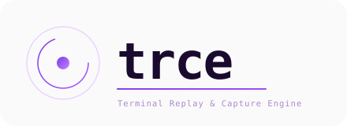

<p align="center">
  
</p>

# TRCE

TRCE est une application web en cours de développement. Le dépôt contient actuellement le socle d'authentification, les premières briques de gestion des équipes et une interface React/Inertia. Les écrans et composants liés aux replays sont encore à construire.

> **État du dépôt :** fondation applicative / prototype. La capture, le stockage, la recherche et le rejeu de transactions ne sont pas encore implémentés.

## Documentation

| Document | Contenu |
|---|---|
| [Présentation produit](docs/product.md) | Objectifs, périmètre fonctionnel, parcours et hypothèses métier |
| [Architecture](docs/architecture.md) | Architecture actuelle, architecture cible, domaines, données, flux et décisions |
| [Design system](docs/design-system.md) | Identité visuelle, tokens, composants, règles d'interface et accessibilité |
| [Guide développeur](docs/development.md) | Prérequis, installation, configuration, commandes et conventions |
| [Sécurité & exploitation](docs/security-operations.md) | Contrôles actuels, écarts, exigences et préparation à la production |
| [Mise à niveau AdonisJS 7.6.0](docs/upgrade-adonisjs-7.6.0.md) | Changement de version, mise à jour du lockfile et vérifications |

## Stack technique

- **Runtime :** Node.js 24 ou supérieur, TypeScript.
- **Backend :** AdonisJS 7.6.0, Lucid ORM, VineJS, Bouncer.
- **Frontend :** React 19, Inertia.js 2, Vite 7, Tailwind CSS 4.
- **UI :** composants locaux inspirés de shadcn/ui, Base UI, Lucide React.
- **Base de données :** PostgreSQL (connexion par défaut) ou SQLite.
- **E-mail :** transport SMTP ; Mailpit est fourni pour le développement local.

## Démarrage rapide

1. Installer Node.js 24+ et Docker Compose.
2. Copier `.env.example` vers `.env`, puis définir `APP_KEY`.
3. Démarrer les dépendances locales :

   ```bash
   docker compose up -d db whodb mailpit
   ```

4. Régénérer le lockfile de la mise à niveau, installer les dépendances et initialiser la base :

   ```bash
   npm install --package-lock-only --ignore-scripts
   npm ci
   node ace generate:key
   node ace migration:run
   ```

5. Démarrer l'application :

   ```bash
   npm run dev
   ```

L'application est disponible sur `http://localhost:3333`. Mailpit est accessible sur `http://localhost:8025` et WhoDB sur `http://localhost:8080`.

Les détails, notamment la configuration d'environnement et la création du premier administrateur, sont décrits dans le [guide développeur](docs/development.md).

## Scripts disponibles

```bash
npm run dev       # serveur de développement AdonisJS + Vite
npm run build     # build de production
npm run start     # démarrage du build
npm run test      # tests Japa
npm run lint      # ESLint
npm run typecheck # vérification TypeScript backend et frontend
```

## Conventions documentaires

La documentation distingue systématiquement :

- **Existant** : comportement vérifiable dans le dépôt.
- **À compléter** : fonctionnalité ou contrôle partiellement présent.
- **Cible proposée** : recommandation d'architecture ou de produit à valider avant implémentation.

Cette distinction est importante : les schémas et endpoints proposés dans les documents ne sont pas nécessairement déjà créés dans le code.
