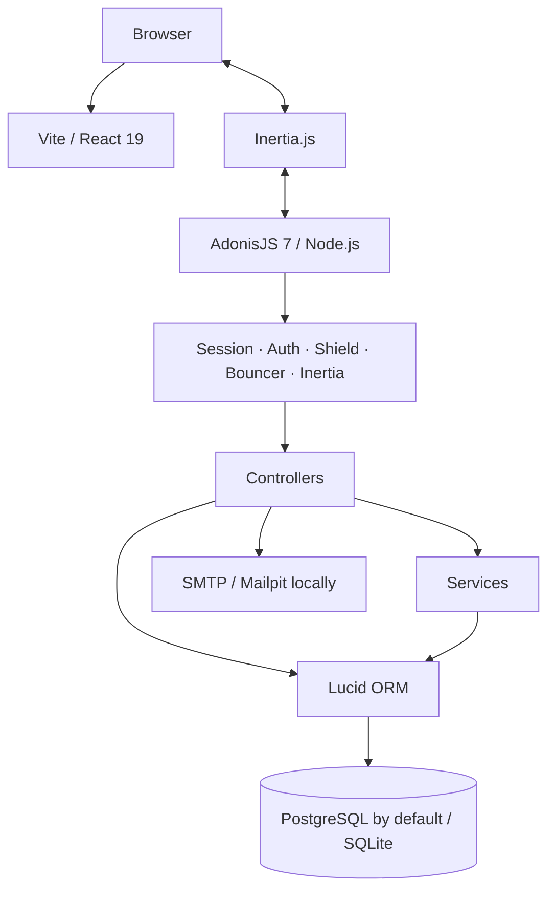
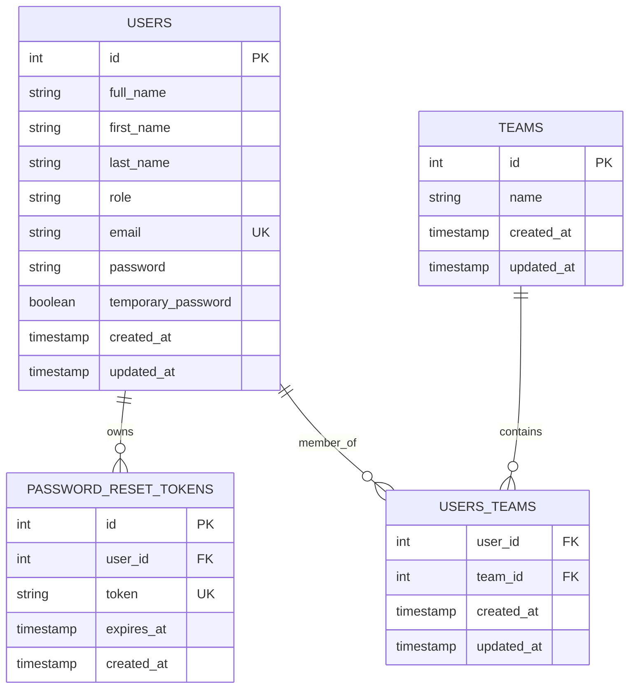
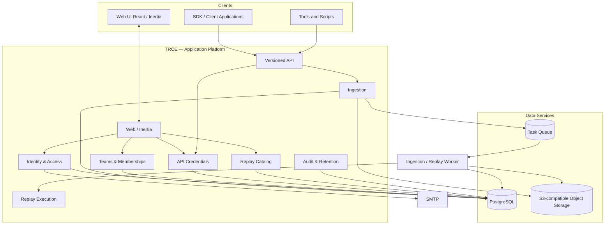
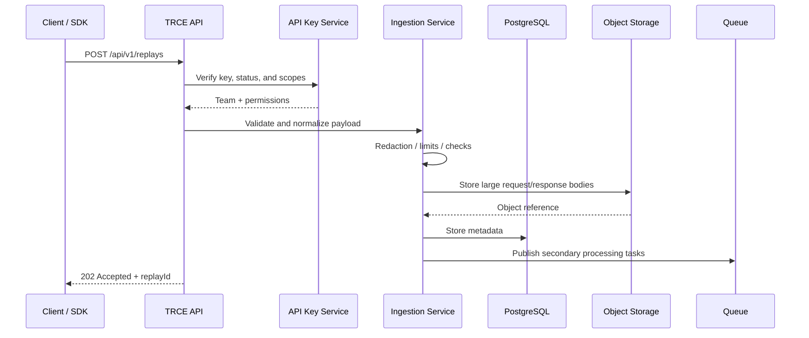
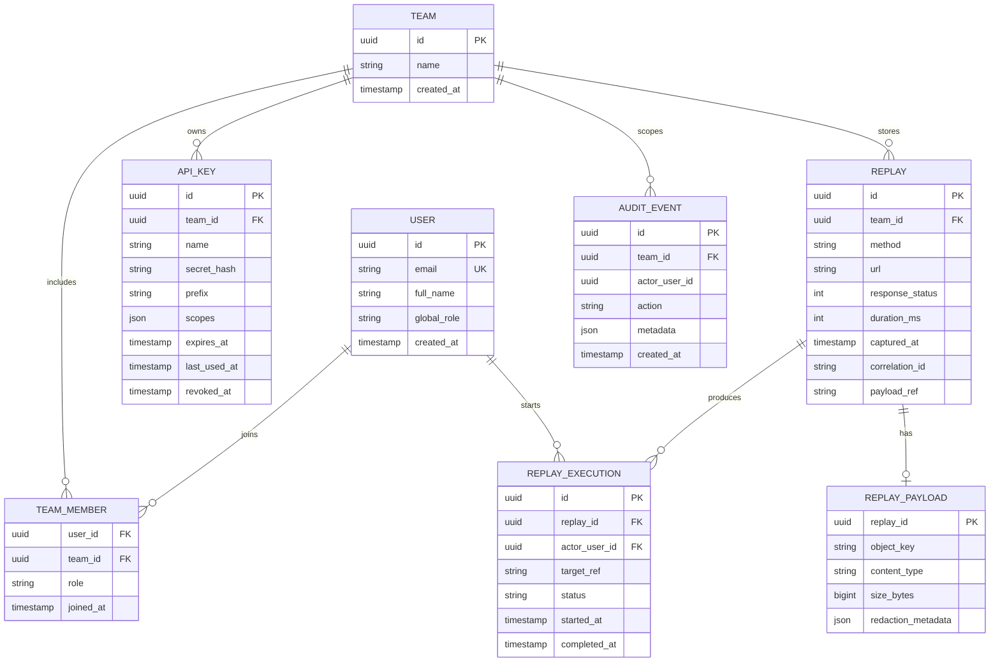
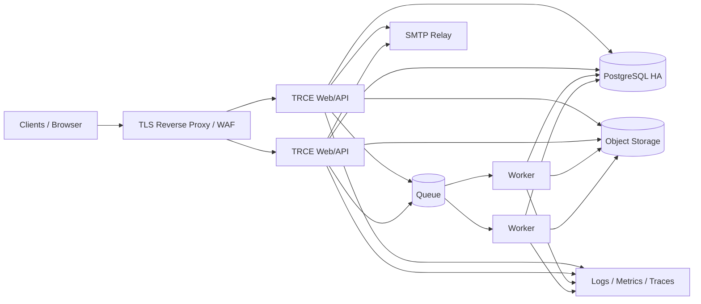

# TRCE Software Architecture

> This document distinguishes between the **existing architecture** (as observed in the repository) and the **proposed target architecture**. The capture, payload storage, and replay components still need to be designed and implemented.

## 1. Guiding Principles

- Keep the existing technology stack unless a concrete requirement justifies a change.
- Start with an AdonisJS **modular monolith** rather than microservices.
- Isolate business responsibilities into explicit modules.
- Make `Team` the security and data ownership boundary for business data.
- Separate relational metadata from large payloads.
- Design ingestion to handle increasing volumes without making synchronous requests dependent on expensive processing.
- Treat replay execution as a sensitive capability that must run in an isolated environment.

## 2. Current Architecture — Repository Status

### 2.1 Logical Overview



The frontend is integrated into the AdonisJS application through Inertia and Vite. React pages are located in `inertia/pages`, shared components in `inertia/components`, and global styles in `inertia/css/app.css`.

### 2.2 Relevant Directory Structure

| Directory | Observed responsibility |
|---|---|
| `app/controllers` | HTTP controllers: sessions, password changes and resets, teams |
| `app/models` | Lucid models: User, Team, PasswordResetToken |
| `app/services` | Business services; TeamService already exists |
| `app/policies` | Bouncer policies; TeamPolicy already exists |
| `app/validators` | VineJS validators |
| `app/middleware` | Authentication, Inertia sessions, Bouncer, password change enforcement |
| `app/transformers` | Serialization of models into Inertia props |
| `database/migrations` | Relational database schema |
| `inertia/pages` | React pages rendered through Inertia |
| `inertia/components/ui` | UI component library |
| `config` | AdonisJS, database, sessions, mail, and security configuration |
| `providers/api_provider.ts` | Shared JSON serializer, with no business endpoint identified at this stage |

### 2.3 Currently Declared Routes

| Route | Method | Control / behavior |
|---|---|---|
| `/login` | GET | Login form, guest-only group |
| `/login` | POST | Session-based authentication |
| `/forgot-password` | GET / POST | Password reset request |
| `/reset-password/:token` | GET | Displays the form after verifying the token in the database |
| `/reset-password` | POST | Password reset |
| `/password/change` | GET / POST | Password change for the authenticated user |
| `/replays` | GET | Placeholder page |
| `/teams` | GET | Team listing |
| `/teams` | POST | Team creation |
| `/teams/:id` | GET | Route declared, controller not implemented |
| `/teams` | PUT / DELETE | Routes declared, controllers not implemented |
| `/users` | GET | Placeholder page |
| `/profile` | GET | Placeholder page |
| `/logout` | POST | Session-based logout |

There is currently no API route for ingesting or retrieving replays.

### 2.4 Current Data Model



**Identified limitations:**

- `User` and `Team` do not yet expose the Lucid `manyToMany` relationships required for the `users_teams` pivot table.
- The `users_teams` table currently allows nullable foreign keys.
- The `TeamService.list()` method returns all teams to administrators and an empty list to other users; team membership is not yet taken into account.
- The API key model and Replay models do not exist yet.

## 3. Proposed Target Architecture

### 3.1 Approach: Modular Monolith

The backend remains a single AdonisJS deployment, but the code is organized around business domains. This approach keeps operations simple initially while establishing clear boundaries that will make it possible to extract a worker or ingestion service later if workload requirements justify it.



`Queue`, object storage, and workers are **proposed target components**, not dependencies currently present in the repository.

### 3.2 Backend Modules

Suggested organization, without immediately requiring a complete physical migration:

```text
app/
  modules/
    identity/
      controllers/ services/ validators/ policies/
    teams/
      controllers/ services/ validators/ policies/
    api_keys/
      controllers/ services/ validators/ policies/
    ingestion/
      controllers/ services/ validators/
    replays/
      controllers/ services/ queries/ policies/
    replay_execution/
      services/ workers/ policies/
    audit/
      services/ models/
    retention/
      services/ workers/
  middleware/
  models/
  transformers/
```

The migration can be gradual. It is preferable not to move all existing code before having a test suite that protects current behavior.

### 3.3 Responsibilities by Domain

| Domain | Responsibility |
|---|---|
| Identity | Authentication, sessions, users, password resets |
| Teams | Teams, members, roles, tenant isolation |
| API Keys | Creation, hashing, scopes, expiration, revocation, rotation, and last usage |
| Ingestion | Authenticate the client, validate the contract, filter data, and persist metadata and payloads |
| Replays | Search, pagination, details, export, and access control |
| Replay Execution | Execute a replay attempt in an isolated worker and record its result |
| Audit | Record important actions and security events |
| Retention | Automated purging based on retention policies |

## 4. Target Technical Flows

### 4.1 Ingestion



Principles:

- The API is versioned (`/api/v1`).
- Metadata is persisted in PostgreSQL.
- Large request/response bodies are stored outside the database, in S3-compatible object storage.
- The ingestion response does not depend on long-running analysis or indexing operations.
- Queue message publishing must be reliable: consider implementing a transactional outbox if PostgreSQL/queue consistency is required.
- Payload size limits, accepted formats, timeouts, and quotas must be explicitly defined.

Choosing `202 Accepted` assumes that secondary processing is asynchronous. The exact ingestion success semantics must be defined before finalizing the API contract.

### 4.2 Retrieval

The browser communicates with the backend through Inertia. The backend retrieves data while systematically applying the `team_id` filter derived from the authorized context, rather than one freely provided by the client.

API endpoints and web pages may share business services and authorization rules, but their representation formats must not be coupled accidentally.

### 4.3 Replay Execution — Security Requirements

Replay execution is a potentially dangerous capability. The worker must:

- Run with a dedicated identity and minimum permissions.
- Deny private, link-local, loopback, and cloud metadata addresses by default.
- Enforce a domain/target allowlist or an equivalent policy.
- Validate DNS resolution, redirects, and destination IP addresses to prevent SSRF bypasses.
- Enforce timeouts, payload size limits, quotas, and concurrency limits.
- Isolate secrets and never log tokens or cookies.
- Require explicit user action before executing operations that may have side effects.
- Record the initiator, target, timestamp, result, and source replay identifier.

It must also be determined whether replays can only target test environments or whether production environments may also be authorized.

## 5. Target Data Model

Conceptual proposal, to be validated against the business requirements:



### 5.1 Data Modeling Rules

- Use non-predictable identifiers exposed through APIs (UUID or ULID); internal identifiers may remain numeric if the requirements are limited to a single installation.
- Make foreign keys mandatory unless a specific business requirement justifies nullable values.
- Add indexes on `team_id`, `captured_at`, `method`, `response_status`, and the search keys actually used.
- Maintain a `team_id` on every business entity that requires tenant isolation.
- Avoid storing large payloads in PostgreSQL.
- Never store API keys in plaintext; only retain a strong hash and an identification prefix.
- For large events, keep metadata separate from the content object.

## 6. Proposed API Contracts

These routes are design examples, not currently implemented routes.

| Method | Target endpoint | Purpose |
|---|---|---|
| POST | `/api/v1/replays` | Ingest an HTTP exchange or replay |
| GET | `/api/v1/replays` | Search and paginate the team's replays |
| GET | `/api/v1/replays/:id` | Retrieve metadata and content references |
| DELETE | `/api/v1/replays/:id` | Delete according to permissions and retention policy |
| POST | `/api/v1/replays/:id/executions` | Trigger a controlled replay execution, if retained |
| GET | `/api/v1/replays/:id/executions` | Retrieve replay execution attempts |
| POST | `/api/v1/api-keys` | Create an API key |
| DELETE | `/api/v1/api-keys/:id` | Revoke an API key |

### 6.1 Response Convention

The `providers/api_provider.ts` provider already exposes a serializer that wraps responses under `data`. It can serve as the foundation for a consistent convention, potentially extended with:

```json
{
  "data": {},
  "meta": {
    "requestId": "..."
  }
}
```

For errors, use a stable, documented format that does not expose internal implementation details:

```json
{
  "error": {
    "code": "VALIDATION_ERROR",
    "message": "The request is invalid",
    "requestId": "...",
    "details": []
  }
}
```

Do not introduce a `meta` or `error` envelope without implementing and testing it in shared middleware or a common serialization mechanism.

## 7. Security and Isolation

### 7.1 Authorization Boundary

- React pages are never a security boundary.
- Every resource read or write must verify team membership and the required role on the backend.
- Access controls must be centralized in policies/services and then invoked by each controller.
- A resource identifier supplied by the client never proves that the resource belongs to the client's team.

### 7.2 API Keys

- Cryptographically secure key generation.
- Display the secret only once.
- Store a non-reversible hash of the secret in the database.
- Use a public prefix to identify the key without revealing it.
- Apply minimum required scopes, an expiration date, and immediate revocation.
- Support rotation with a controlled overlap period when necessary.
- Update `last_used_at` without triggering an expensive database write on every request (batching or caching may be considered).
- Apply rate limiting by API key, team, and IP address depending on the context.

### 7.3 Captured Data

Requests and responses may contain passwords, cookies, tokens, personal data, or sensitive business information. The following measures must be considered:

- Configurable redaction rules (headers, JSON fields, query parameters).
- Global default exclusions (`Authorization`, `Cookie`, `Set-Cookie`, known secrets).
- Encryption in transit and at rest.
- Fine-grained access control for payloads.
- Maximum payload sizes and download limits.
- Retention policies and verifiable deletion.
- Exclusion of secrets from logs, traces, and error messages.

## 8. Target Deployment Architecture



Target components:

- TLS reverse proxy and application-layer protection.
- Stateless application instances.
- PostgreSQL with backups and a tested recovery mechanism.
- S3-compatible object storage for payloads.
- Queue and workers for deferred ingestion processing, retention cleanup, and replay execution.
- SMTP relay.
- Centralized collection of logs, metrics, and traces.

The provider and high availability requirements must be sized after defining expected volumes, payload sizes, and RPO/RTO objectives.

## 9. Observability

The following capabilities should be implemented:

- Structured JSON logs.
- A `request_id` propagated to logs and responses.
- `team_id`, `replay_id`, and `api_key_id` represented as non-secret identifiers in events.
- Ingestion metrics (throughput, errors, latency, size, backlog).
- Worker metrics (duration, failures, retries, queue depth).
- Database and storage metrics.
- Distributed tracing if multiple processes or services are introduced.

Never use a complete URL, email address, API key, or high-cardinality identifier as a metric label.

## 10. Proposed Architecture Decisions

| ID | Decision | Rationale | Status |
|---|---|---|---|
| ADR-001 | Keep AdonisJS + React/Inertia | Existing and consistent technology stack | To be confirmed |
| ADR-002 | Modular monolith before microservices | Reduce initial operational complexity | Recommended |
| ADR-003 | Use PostgreSQL for business metadata | Transactions, relationships, structured search | Recommended |
| ADR-004 | Use object storage for large payloads | Avoid excessive growth of the relational database | To be validated against expected volumes |
| ADR-005 | Use Team as the tenant / authorization boundary | Consistent with the organization already in place | Recommended |
| ADR-006 | Version the ingestion API | Allow client SDKs to evolve | Recommended |
| ADR-007 | Use an isolated worker for replay execution | Reduce SSRF risks and side effects | To be validated against replay requirements |

## 11. Topics to Address Before Implementation

1. Confirm the business definition of a replay and whether replay execution is required.
2. Define the ingestion format and compatibility strategy.
3. Define expected volumes, limits, RPO/RTO, and retention policies.
4. Define team roles and access control rules.
5. Design the protection mechanisms for captured data.
6. Add authorization, ingestion, and multi-team isolation tests before exposing the API.
