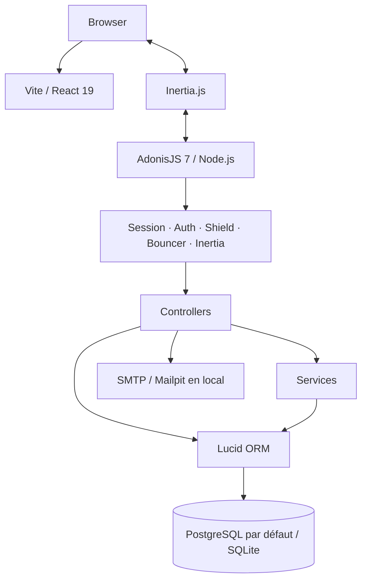
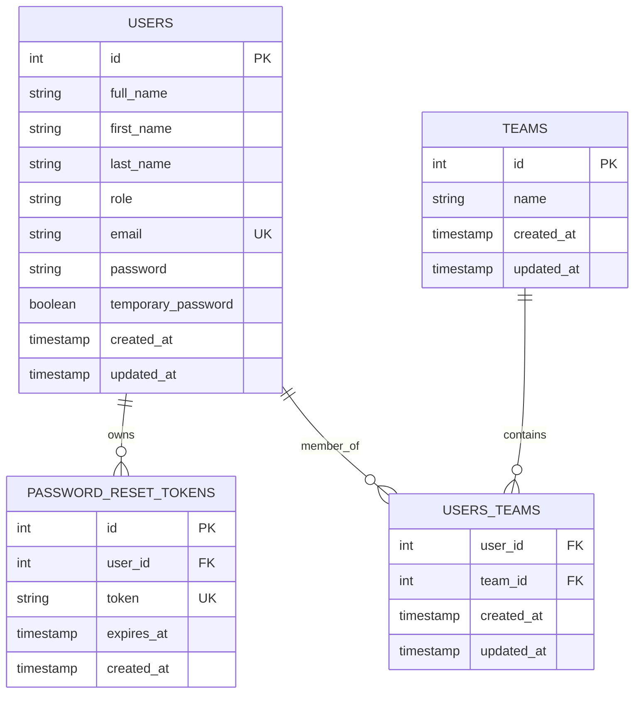
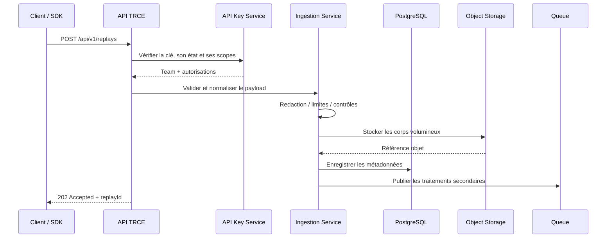
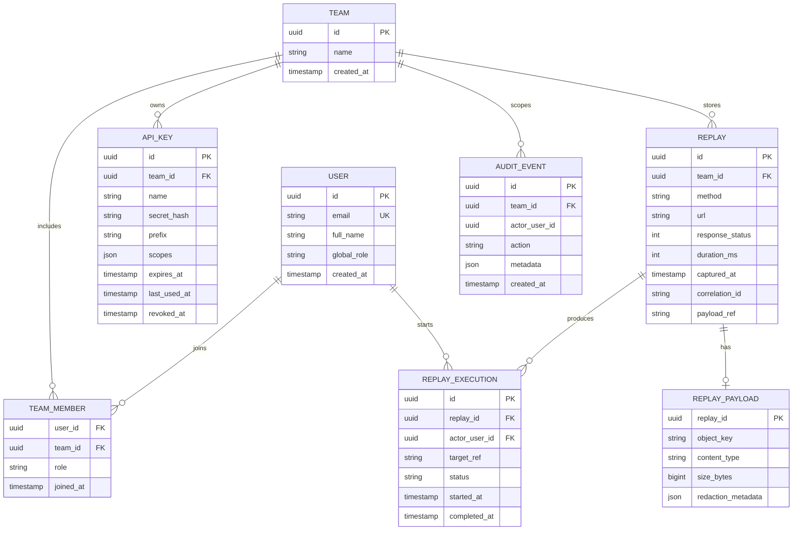
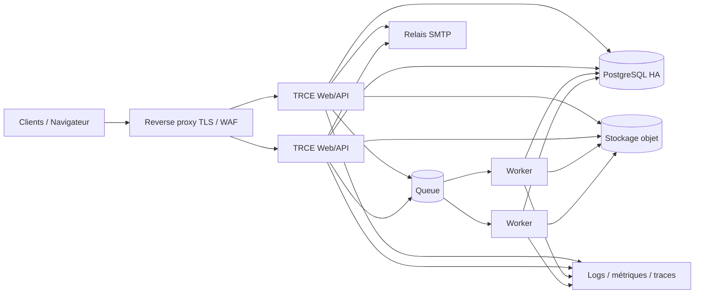

# Architecture logicielle TRCE

> Ce document sépare l'architecture **existante** (constatée dans le dépôt) de l'architecture **cible proposée**. Les composants de capture, de stockage des payloads et de rejeu restent à concevoir et à implémenter.

## 1. Principes directeurs

- Conserver la stack existante tant qu'un besoin concret ne justifie pas un changement.
- Commencer par un **monolithe modulaire** AdonisJS plutôt que par des microservices.
- Isoler les responsabilités métier dans des modules explicites.
- Faire de `Team` la frontière de sécurité et de propriété des données métier.
- Séparer les métadonnées relationnelles des payloads volumineux.
- Concevoir l'ingestion pour supporter des volumes croissants sans rendre la requête synchrone dépendante de traitements coûteux.
- Traiter le rejeu comme une capacité sensible, exécutée dans un environnement isolé.

## 2. Architecture actuelle — état du dépôt

### 2.1 Vue logique



Le frontend est intégré à l'application AdonisJS via Inertia et Vite. Les pages React sont dans `inertia/pages`, les composants partagés dans `inertia/components` et les styles globaux dans `inertia/css/app.css`.

### 2.2 Structure utile

| Répertoire | Responsabilité constatée |
|---|---|
| `app/controllers` | Contrôleurs HTTP : session, changement et réinitialisation du mot de passe, équipes |
| `app/models` | Modèles Lucid : User, Team, PasswordResetToken |
| `app/services` | Services métier ; TeamService existe |
| `app/policies` | Policies Bouncer ; TeamPolicy existe |
| `app/validators` | Validateurs VineJS |
| `app/middleware` | Authentification, session Inertia, Bouncer, changement de mot de passe |
| `app/transformers` | Sérialisation des modèles vers les props Inertia |
| `database/migrations` | Schéma relationnel |
| `inertia/pages` | Pages React rendues par Inertia |
| `inertia/components/ui` | Bibliothèque de composants d'interface |
| `config` | Configuration AdonisJS, base, sessions, mail, sécurité |
| `providers/api_provider.ts` | Sérialiseur JSON partagé, sans endpoint métier identifié à ce stade |

### 2.3 Routes actuellement déclarées

| Route | Méthode | Contrôle / comportement |
|---|---|---|
| `/login` | GET | Formulaire de connexion, groupe guest |
| `/login` | POST | Authentification par session |
| `/forgot-password` | GET / POST | Demande de réinitialisation |
| `/reset-password/:token` | GET | Présentation du formulaire après vérification du token en base |
| `/reset-password` | POST | Réinitialisation du mot de passe |
| `/password/change` | GET / POST | Changement du mot de passe connecté |
| `/replays` | GET | Page placeholder |
| `/teams` | GET | Liste des équipes |
| `/teams` | POST | Création d'équipe |
| `/teams/:id` | GET | Route déclarée, contrôleur non implémenté |
| `/teams` | PUT / DELETE | Routes déclarées, contrôleurs non implémentés |
| `/users` | GET | Page placeholder |
| `/profile` | GET | Page placeholder |
| `/logout` | POST | Déconnexion par session |

Il n'existe pas encore de route API d'ingestion ou de consultation des replays.

### 2.4 Modèle de données actuel



**Limites constatées :**

- `User` et `Team` n'exposent pas encore les relations Lucid `manyToMany` nécessaires à la jointure `users_teams`.
- La table `users_teams` autorise actuellement des clés étrangères nulles.
- Le service `TeamService.list()` renvoie toutes les équipes aux administrateurs et une liste vide aux autres utilisateurs ; l'appartenance à une équipe n'est pas encore exploitée.
- Le modèle de clé API et les modèles Replay n'existent pas.

## 3. Architecture cible proposée

### 3.1 Choix : monolithe modulaire

Le backend reste un seul déploiement AdonisJS, mais le code est organisé par domaines métier. Cette approche permet de garder une exploitation simple au début, tout en préparant des frontières claires pour extraire ultérieurement un worker ou un service d'ingestion si la charge le justifie.


`Queue`, stockage objet et worker sont des composants **cibles proposés**, pas des dépendances présentes dans le dépôt.

### 3.2 Modules backend

Organisation suggérée, sans imposer immédiatement une migration physique complète :

```text
app/
  modules/
    identity/
      controllers/ services/ validators/ policies/
    teams/
      controllers/ services/ validators/ policies/
    api_keys/
      controllers/ services/ validators/ policies/
    ingestion/
      controllers/ services/ validators/
    replays/
      controllers/ services/ queries/ policies/
    replay_execution/
      services/ workers/ policies/
    audit/
      services/ models/
    retention/
      services/ workers/
  middleware/
  models/
  transformers/
```

Le découpage peut rester progressif. Il est préférable de ne pas déplacer tout le code actuel avant d'avoir une suite de tests qui sécurise les comportements existants.

### 3.3 Responsabilités par domaine

| Domaine | Responsabilité |
|---|---|
| Identity | Connexion, sessions, utilisateurs, réinitialisation des mots de passe |
| Teams | Équipes, membres, rôles, cloisonnement tenant |
| API Keys | Création, hash, scopes, expiration, révocation, rotation et dernière utilisation |
| Ingestion | Authentifier le client, valider le contrat, filtrer les données, enregistrer les métadonnées et payloads |
| Replays | Recherche, pagination, détail, export et règles d'accès |
| Replay Execution | Exécuter une tentative de rejeu dans un worker isolé et enregistrer son résultat |
| Audit | Historiser les actions importantes et les événements de sécurité |
| Retention | Purge automatisée en fonction des politiques de conservation |

## 4. Flux techniques cibles

### 4.1 Ingestion



Principes :

- L'API est versionnée (`/api/v1`).
- Les métadonnées sont persistées en PostgreSQL.
- Les corps volumineux sont stockés hors base, dans un stockage objet compatible S3.
- La réponse d'ingestion ne dépend pas d'un traitement d'analyse ou d'indexation long.
- L'écriture du message en file doit être fiable : prévoir une transaction outbox si la cohérence PostgreSQL/file est nécessaire.
- Les limites de taille, formats acceptés, timeouts et quotas doivent être explicites.

Le choix d'un `202 Accepted` suppose que les traitements secondaires sont asynchrones. Il faudra définir le comportement exact de succès d'ingestion avant de figer le contrat.

### 4.2 Consultation

Le navigateur appelle le backend via Inertia. Le backend récupère les données en appliquant systématiquement le filtre `team_id` issu du contexte autorisé, et non fourni librement par le client.

Les endpoints API et les pages web peuvent partager des services métier et des règles d'autorisation, mais ne doivent pas partager leurs formats de représentation par accident.

### 4.3 Rejeu — exigences de sécurité

Le rejeu est une capacité à risque. Le worker devra :

- fonctionner avec une identité et des permissions minimales ;
- interdire par défaut les adresses privées, link-local, loopback et les métadonnées cloud ;
- appliquer une allowlist de domaines/cibles ou une politique équivalente ;
- contrôler DNS, redirections et résolution d'adresse pour éviter les contournements SSRF ;
- imposer des timeouts, plafonds de taille, quotas et limites de concurrence ;
- isoler les secrets et ne pas journaliser les tokens/cookies ;
- demander une action explicite avant une exécution susceptible d'avoir des effets de bord ;
- enregistrer l'auteur, la cible, la date, le résultat et l'identifiant du replay source.

Il faut aussi déterminer si les replays sont exécutés vers une cible de test uniquement, ou si des environnements de production peuvent être autorisés.

## 5. Modèle de données cible

Proposition conceptuelle, à valider en fonction du contrat métier :



### 5.1 Règles de modélisation

- Utiliser des identifiants non prédictibles exposés dans les API (UUID ou ULID) ; les identifiants internes peuvent rester numériques si le besoin est limité à une installation unique.
- Rendre les clés étrangères obligatoires sauf cas métier explicitement justifié.
- Ajouter des index sur `team_id`, `captured_at`, `method`, `response_status` et les clés de recherche réellement utilisées.
- Conserver un `team_id` sur chaque entité métier qui doit être cloisonnée.
- Éviter de stocker les payloads volumineux dans PostgreSQL.
- Ne jamais persister une clé API en clair ; conserver uniquement un hash robuste et un préfixe d'identification.
- Pour les événements volumineux, distinguer les métadonnées de l'objet de contenu.

## 6. Contrats API proposés

Ces routes sont des exemples de conception, pas des routes actuellement implémentées.

| Méthode | Endpoint cible | Objet |
|---|---|---|
| POST | `/api/v1/replays` | Ingérer un échange ou un replay |
| GET | `/api/v1/replays` | Rechercher et paginer les replays de l'équipe |
| GET | `/api/v1/replays/:id` | Lire les métadonnées et les références de contenu |
| DELETE | `/api/v1/replays/:id` | Supprimer selon les droits et la politique de rétention |
| POST | `/api/v1/replays/:id/executions` | Déclencher un rejeu contrôlé, si retenu |
| GET | `/api/v1/replays/:id/executions` | Consulter les tentatives de rejeu |
| POST | `/api/v1/api-keys` | Créer une clé API |
| DELETE | `/api/v1/api-keys/:id` | Révoquer une clé API |

### 6.1 Convention de réponse

Le provider `providers/api_provider.ts` fournit déjà un sérialiseur qui enveloppe les réponses sous `data`. Il peut servir de base à une convention uniforme, à compléter avec :

```json
{
  "data": {},
  "meta": {
    "requestId": "..."
  }
}
```

Pour les erreurs, retenir un format stable, documenté, sans exposer les détails internes :

```json
{
  "error": {
    "code": "VALIDATION_ERROR",
    "message": "The request is invalid",
    "requestId": "...",
    "details": []
  }
}
```

Ne pas introduire une enveloppe `meta` ou `error` sans l'implémenter et la tester dans un middleware ou un mécanisme de sérialisation commun.

## 7. Sécurité et isolation

### 7.1 Frontière d'autorisation

- Les pages React ne sont jamais une frontière de sécurité.
- Toute lecture ou écriture d'une ressource doit vérifier l'appartenance à l'équipe et le rôle requis côté backend.
- Les contrôles d'accès doivent être centralisés dans des policies/services, puis appelés par chaque contrôleur.
- Un identifiant de ressource fourni par le client ne prouve jamais son appartenance à l'équipe.

### 7.2 API Keys

- Génération cryptographiquement sûre.
- Affichage du secret une seule fois.
- Hash non réversible du secret en base.
- Préfixe public pour identifier la clé sans la révéler.
- Scopes minimaux, date d'expiration et révocation immédiate.
- Rotation avec période de chevauchement contrôlée si nécessaire.
- `last_used_at` actualisé sans provoquer une écriture coûteuse à chaque appel (batch/cache éventuel).
- Rate limiting par clé, équipe et IP selon le contexte.

### 7.3 Données capturées

Les requêtes/réponses peuvent contenir des mots de passe, cookies, tokens, données personnelles ou informations métier sensibles. Prévoir :

- règles de masquage configurables (headers, champs JSON, paramètres) ;
- exclusions globales par défaut (`Authorization`, `Cookie`, `Set-Cookie`, secrets connus) ;
- chiffrement en transit et au repos ;
- contrôle d'accès fin aux payloads ;
- tailles maximales et limites de téléchargement ;
- rétention et suppression vérifiable ;
- exclusion des secrets des logs, traces et messages d'erreur.

## 8. Déploiement cible



Composants cible :

- reverse proxy TLS et protection applicative ;
- instances stateless de l'application ;
- PostgreSQL avec sauvegardes et mécanisme de restauration testé ;
- stockage objet compatible S3 pour les payloads ;
- queue et workers pour l'ingestion différée, la purge et le rejeu ;
- relais SMTP ;
- collecte centralisée des logs, métriques et traces.

Le choix du fournisseur et le niveau de haute disponibilité sont à dimensionner après définition des volumes, des tailles de payload et des objectifs RPO/RTO.

## 9. Observabilité

À mettre en place :

- logs structurés JSON ;
- `request_id` propagé aux logs et réponses ;
- `team_id`, `replay_id` et `api_key_id` sous forme d'identifiants non secrets dans les événements ;
- métriques d'ingestion (débit, erreurs, latence, taille, backlog) ;
- métriques des workers (durée, échecs, retries, files) ;
- métriques de base et stockage ;
- traces distribuées si plusieurs processus ou services sont introduits.

Ne jamais placer dans les labels de métriques une URL complète, un e-mail, une clé API ou un identifiant à forte cardinalité.

## 10. Décisions d'architecture proposées

| ID | Décision | Motif | Statut |
|---|---|---|---|
| ADR-001 | Conserver AdonisJS + React/Inertia | Stack déjà en place et cohérente | À confirmer |
| ADR-002 | Monolithe modulaire avant microservices | Réduire la complexité d'exploitation initiale | Recommandé |
| ADR-003 | PostgreSQL pour les métadonnées métier | Transactions, relations, recherche structurée | Recommandé |
| ADR-004 | Stockage objet pour les corps volumineux | Éviter de gonfler la base relationnelle | À valider selon volumes |
| ADR-005 | Team comme tenant / périmètre d'autorisation | Correspond à l'organisation déjà amorcée | Recommandé |
| ADR-006 | API d'ingestion versionnée | Permettre l'évolution des SDK clients | Recommandé |
| ADR-007 | Worker isolé pour le rejeu | Réduire les risques SSRF et les effets de bord | À valider avec le besoin de rejeu |

## 11. Points à traiter avant la mise en œuvre

1. Confirmer la définition métier du replay et la nécessité du rejeu.
2. Fixer le format d'ingestion et la stratégie de compatibilité.
3. Définir les volumes, limites, RPO/RTO et rétention.
4. Définir les rôles d'équipe et les règles d'accès.
5. Concevoir la protection des données capturées.
6. Ajouter tests d'autorisation, d'ingestion et de cloisonnement multi-équipe avant d'ouvrir l'API.
